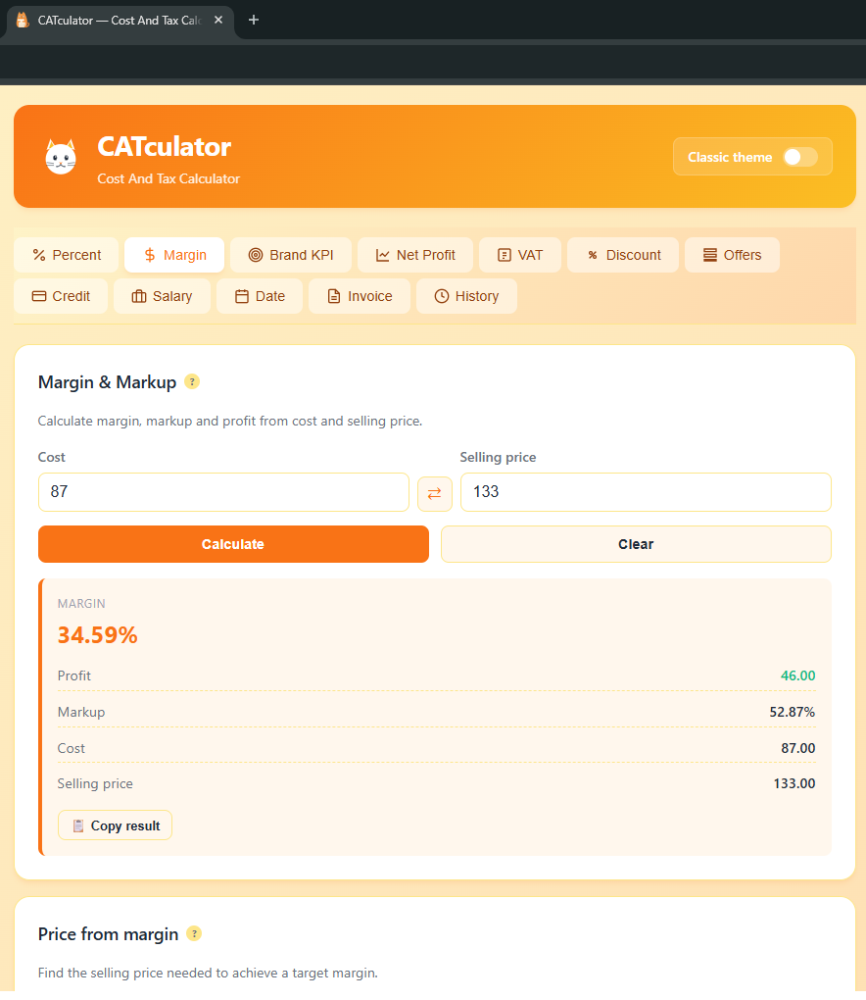
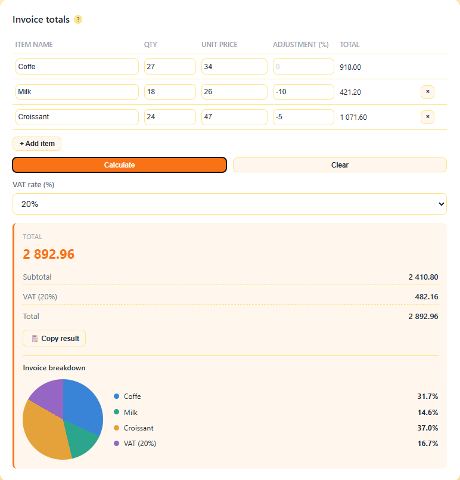
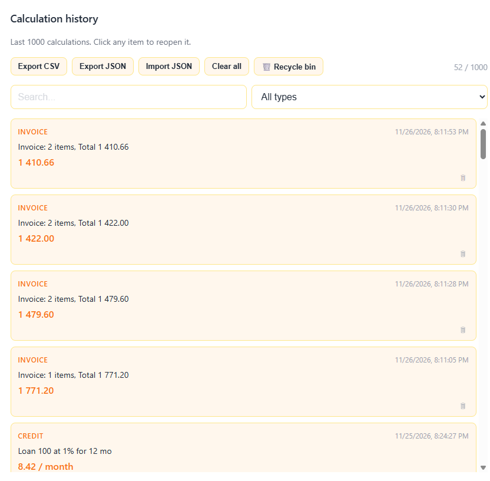

# 🐱 CATculator

**Cost And Tax Calculator** — a collection of practical calculators for business, finance, pricing, and date calculations.

CATculator is a browser-based application with a simple interface, two visual themes, and calculation history. It runs entirely in your browser — no account, installation, or server required.

**[🚀 Open CATculator](https://iuriimel.github.io/CATculator/)**

---

## ✨ Features

### 📊 Percentages & Margins

- Calculate a percentage of a number.
- Calculate percentage increase or decrease.
- Find the percentage change between two values.
- Calculate what percentage one value is of another.
- Calculate profit margin and markup.
- Find a selling price based on a target margin.
- Convert between markup and margin.
- Calculate the break-even point.

### 📈 Business & Marketing

- **Brand KPI** — compare planned and actual performance.
- **Marketing ROI** — estimate return on marketing investment using revenue and profit margin.
- **Funnel Conversion** — calculate conversion rates across up to four stages.
- **Price Positioning** — calculate your average selling price and compare it with a competitor.
- **Retail Price Builder** — calculate retail price step by step, including logistics, distributor markup, retailer markup, and VAT.
- **Offers Comparison** — compare offers based on unit prices.

### 🏷️ Taxes, Discounts & Pricing

- **VAT Calculator** — add VAT to a price or extract VAT from an existing price.
- **Discount Calculator** — calculate discounted prices and savings.

### 💰 Finance & Payments

- **Net Profit Calculator** — estimate business net profit after operating expenses, other income and expenses, interest, and estimated income tax.
- **Loan / Installment Calculator** — estimate annuity or differentiated loan payments and total overpayment.
- **Early Repayment** — estimate interest savings from repaying a loan early.
- **Salary Calculator** — calculate gross salary from net salary or net salary from gross, including income tax and employer social contributions.

### 🧾 Invoice Generator

Create invoices with multiple line items and automatically calculate totals.

- Add and remove invoice items.
- Enter item names, quantities, and unit prices.
- Apply percentage adjustments to individual items.
- Calculate line totals and the invoice total.
- Select a VAT rate or enter a custom rate.
- Save invoice calculations to history and reopen them later.

### 📅 Date Calculations

- **Date Calculator** — calculate the number of days between two dates or add and subtract days from a date.

### 📚 Calculation History

- Automatically save completed calculations.
- Store up to 1,000 calculation records.
- Search and filter history by calculator type.
- Click a record to reopen it with its saved inputs and result.
- Export history to CSV or JSON.
- Import history from JSON.
- Move unwanted records to the Recycle Bin.
- Restore deleted records or permanently delete them.
- Store up to 100 records in the Recycle Bin.

### 🎨 Interface & Usability

- Two visual themes: Cat and Classic.
- Responsive layout for desktop and mobile screens.
- Automatic calculation updates where supported.
- Tooltips with explanations of calculations and formulas.
- Copy calculation results to the clipboard.
- Print-friendly layouts.
- Remember the selected theme, active tab, and scroll position.

---

## 🔒 Privacy & Storage

CATculator performs calculations locally in your browser.

- No account or registration is required.
- No application server is used to process calculations.
- Calculation history, theme preferences, and interface state are stored in browser `localStorage`.
- Your stored data remains in your browser and is not automatically synchronized between devices.
- Clearing browser data or `localStorage` may permanently erase your saved history and preferences.

You can export your calculation history to keep a separate backup.

---

## ⚙️ Technology

CATculator is built with:

- HTML5
- CSS3
- Vanilla JavaScript
- Browser `localStorage` for local data persistence

The application is contained in a single HTML file and does not require a build process or backend.

---

## 📄 License

See the [LICENSE](LICENSE) file for license information.